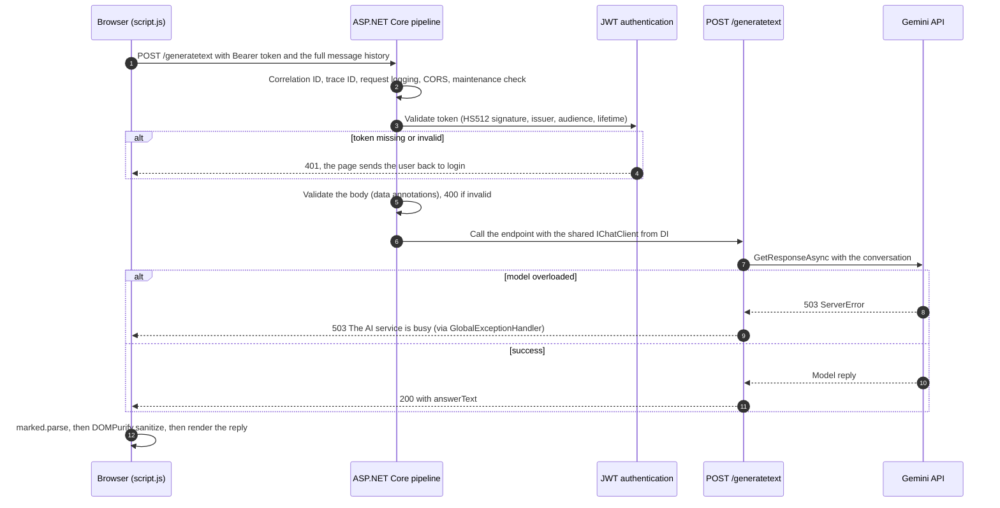

# GeminiChat

A chat web app: a plain HTML/CSS/JavaScript frontend talks to an ASP.NET Core (.NET 10) Minimal API, and the API talks to Google Gemini. The user logs in, gets a JWT and chats with the model. The browser keeps the conversation and sends the whole history with every message, so the API stores nothing between requests.

## About this project

This is a **learning project**. I built it to learn backend development with ASP.NET Core: authentication, middleware, error handling, structured logging, configuration and calling an external AI service.

The code is **intentionally heavily commented**:

- The comments are notes to myself about *why* something is done.
- Blocks marked `ALTERNATIVE` are other designs I compared and kept for reference.
- Some commented-out code shows earlier versions, or is kept for features I plan to add.
- A few types are not used yet: `BadRequestException`, `ConflictException`, `ValidationException` and `RequestLoggingMiddleware`.

In a production codebase these notes would go into documentation, and the source files would keep only working code.

## Features

- **Login with JWT.** One user, configured in user-secrets. The password is stored only as a PBKDF2 hash. A successful login returns a JWT that is valid for 60 minutes.
- **Multi-turn chat with Gemini** through `IChatClient` from Microsoft.Extensions.AI. One client is created once and shared through dependency injection.
- **Input validation** with .NET 10's built-in Minimal API validation. An invalid request gets a `400` with the reason for each field.
- **Central error handling.** A global exception handler logs every unhandled exception and returns a Problem Details response. When Gemini is overloaded, the API returns `503` "The AI service is busy, try again in a moment" instead of a generic `500`.
- **Request tracing.** Every response carries `X-Correlation-Id` and `X-Trace-Id` headers, so a failed request can be found in the logs.
- **Structured logging with Serilog** to the console, to daily JSON files and, optionally, to Seq.
- **Maintenance mode** (`"MaintenanceMode": true` makes every request return `503`) and **request limits** in Kestrel.
- **API documentation** with OpenAPI and Scalar, in Development only.
- **Frontend with no build step.** Login and chat pages; AI replies are rendered as Markdown and sanitized with DOMPurify; each error type gets its own message (an expired login sends the user back to the login page on the next message, invalid input shows the reason, a server error shows its trace ID).
- **Unit tests** (xUnit) for the password hashing.

## Tech stack

- .NET 10, ASP.NET Core Minimal APIs
- Google.GenAI with Microsoft.Extensions.AI (`IChatClient`)
- JWT Bearer authentication
- Serilog, optionally with Seq
- OpenAPI and Scalar
- xUnit
- HTML, CSS and JavaScript without a framework; marked and DOMPurify for Markdown

The chat model is set in `appsettings.json` and uses the `gemini-flash-lite-latest` alias on purpose, so the project keeps working when Google retires older model versions. In production I would pin a specific version.

## Architecture

The backend uses a vertical-slice layout: each feature keeps its request and response types and its endpoint together, and `Program.cs` only wires things up.

```
GeminiChat/
├── backend/                         ASP.NET Core API (GeminiChat.Api.csproj)
│   ├── Program.cs                   service registration and middleware pipeline
│   ├── Features/
│   │   ├── GenerateText.cs          POST /generatetext (chat)
│   │   └── Auth/
│   │       ├── HashProvider.cs      PBKDF2 password hashing
│   │       └── Login/               POST /login, TokenService (JWT creation)
│   ├── Configuration/               JwtSettings, AuthCredentials, GeminiSettings (Options pattern)
│   ├── Extensions/                  AddJwtAuth(), AddGemini() service registrations
│   ├── Middleware/                  correlation ID, trace ID header, maintenance mode
│   └── Exceptions/                  AppException types, GlobalExceptionHandler
├── frontend/                        static pages served by VS Code Live Server
│   ├── login.html, index.html
│   ├── js/login.js, js/script.js
│   └── css/
├── tests/
│   └── GeminiChat.Api.Tests/        xUnit tests for the password hashing
└── GeminiChat.slnx                  solution file listing the backend and test projects
```

Middleware order in `Program.cs`: correlation ID → trace ID header → Serilog request logging → exception handler → CORS → maintenance mode → authentication → authorization → endpoint.

### One chat request



## API

| Method | Route | Auth | Purpose |
|---|---|---|---|
| POST | `/login` | No | Checks the credentials and returns a JWT |
| POST | `/generatetext` | Bearer JWT | Sends the conversation to Gemini and returns the reply |
| GET | `/openapi/v1.json` | No | OpenAPI document (Development only) |
| GET | `/scalar/v1` | No | Scalar API reference UI (Development only) |
| GET | `/test`, `/boom`, `/crash` | No | Development-only endpoints for testing logging (`/test`) and error handling (`/boom` returns 404, `/crash` returns 500) |

The browser sends the whole conversation with every message, with the roles `user` and `ai`. The API accepts 1 to 100 messages, each at most 20,000 characters. Invalid input returns `400` with Problem Details, and a wrong username or password returns `401`.

## Security

- **Passwords.** Only a hash is stored: PBKDF2 with SHA-512, a new random 16-byte salt for every hash, and 100,000 iterations, which makes guessing slow on purpose. Hashes are compared in constant time. The PBKDF2 function comes from .NET (`Rfc2898DeriveBytes.Pbkdf2`); I wrote the salt handling, the storage format and the verification around it myself, to learn how password hashing works. In production I would use ASP.NET Core Identity's `PasswordHasher`.
- **JWT.** Tokens are signed with HMAC-SHA512. Whenever a request carries a token, the API checks its signature, issuer, audience and expiry.
- **Untrusted text in the page.** User messages are inserted as plain text. AI replies are converted from Markdown and sanitized with DOMPurify before they are added to the page. Both libraries are pinned to exact versions and loaded with Subresource Integrity hashes.
- **Secrets.** The Gemini API key, the JWT signing key and the password hash are kept in user-secrets, outside the repository.
- **Other measures.** CORS allows only the frontend's origin. Request sizes are limited. Incoming correlation IDs are validated, so they can't be used to write fake lines into the logs. In Production, an unexpected error returns only a generic message and a trace ID; the details go to the logs.

**Known limitations**

- There is a single user, configured in user-secrets. There is no user database or registration.
- The JWT is kept in `localStorage`, which JavaScript can read if an XSS bug ever gets through. Sanitizing with DOMPurify reduces that risk.
- The password hash is only checked when the username matches, so a wrong username is answered faster than a wrong password. The response time can reveal whether a username exists.
- There is no rate limiting on login or chat.
- A conversation is limited to 100 messages (50 exchanges); after that the API rejects new messages until the page is reloaded.
- The tests cover only the password hashing so far.

## Status

**Done**

- Login with PBKDF2 password hashing and JWT
- Multi-turn chat with Gemini through a shared `IChatClient`
- Validation, central error handling with Problem Details, a `503` for an overloaded model
- Serilog logging with correlation and trace IDs, maintenance mode
- OpenAPI with Scalar, frontend with Markdown rendering and a message for each error type
- Unit tests for the password hashing

**Next**

- Store the chat history in a database with EF Core.
- Deploy the frontend to Netlify and the API to Azure.
